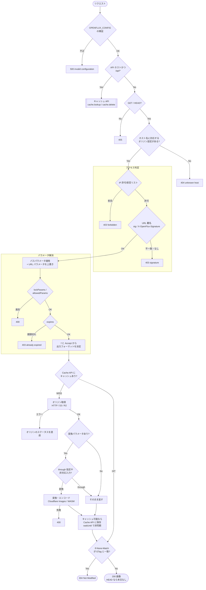
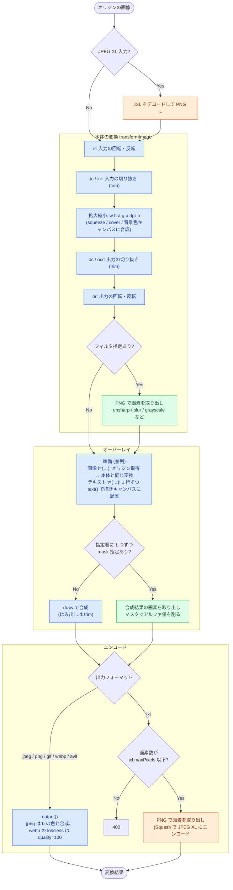

# 構成

[English](ARCHITECTURE.md) | 日本語

層ごとにディレクトリを分けています。
依存の向きは `index.ts` → `http` / `infrastructure` → `application` → `domain` で、`domain` は I/O を持ちません。

| ディレクトリ           | 役割                                                                                                                                                                      |
| ---------------------- | ------------------------------------------------------------------------------------------------------------------------------------------------------------------------- |
| `src/domain/params/`   | 変換パラメータの文法 (`w=400,l=(…)` など) を `Params` にするパーサ。失敗は `ParamError` の `Result`                                                                       |
| `src/domain/geometry/` | 出力サイズ (`ResizePlan`)・切り抜き領域 (`CropArea`)・オーバーレイ位置の計算                                                                                              |
| `src/domain/image/`    | 入力フォーマット判定、`Accept` による出し分け、フィルタ・クリッピングマスク・テキスト行配置の画素計算、フォント解決、変換のポート (`ImageRenderer`)                       |
| `src/domain/config/`   | `OPENFLUX_CONFIG` の zod スキーマ (型はスキーマから導出)。CIDR やパスパラメータの文法も設定の読み込み時に検証する                                                         |
| `src/domain/delivery/` | キャッシュキー・`Cache-Control` の決定・ETag、キャッシュのポート                                                                                                          |
| `src/domain/access/`   | URL 署名 (HMAC-SHA256) とアクセス判定のエラー                                                                                                                             |
| `src/domain/source/`   | オリジンのパス (`ObjectPath`)・取得結果、取得のポート (`SourceResolver`)                                                                                                  |
| `src/domain/shared/`   | 共通部品: 判別共用体の網羅性チェック (`assertNever`)、Standard Schema (zod) の検証結果を `Result` にする `schemaResult`                                                   |
| `src/application/`     | ワークフロー: 画像配信 (`serveImage`) とキャッシュ API。`safeTry` で `Result` を合成する                                                                                  |
| `src/infrastructure/`  | アダプタ: Cloudflare Images による変換、HTTP / S3 / R2 オリジン、Cache API、Purge API、WASM コーデック、env の検証                                                        |
| `src/http/`            | ワークフローのエラー (判別共用体) を HTTP 応答に対応付ける                                                                                                                |
| `src/index.ts`         | コンポジションルート。[Hono](https://hono.dev/) アプリで env の検証・ルーティングを行い、アダプタを組み立ててワークフローを呼ぶ。予期しない例外は `onError` で 500 にする |

エラーの扱い:

- パラメータの誤り・署名不一致・オリジンの 404 など、呼び出し側が応答を選ぶ失敗は `Result` のエラー (判別共用体) で返し、`src/http/` で `switch` により網羅的に応答へ対応付ける
- 通信障害や Images binding の内部エラーなど予期しない失敗は例外のまま `index.ts` まで伝え、500 にする
- 設定 (`OPENFLUX_CONFIG`) の誤りは起動時の検証で 500 `invalid configuration: …` になる

## 配信の流れ

リクエストは `src/index.ts` で振り分けられ、画像配信は `src/application/serve-image.ts` のワークフローで処理されます。
途中で失敗した場合は、ステータスとメッセージだけのエラー (`text/plain`, `Cache-Control: no-store`) を返します。

- キャッシュキーはリクエスト URL。`f=webp:auto` などの代替フォーマット指定では、選ばれたフォーマットごとに別キーで保存し `Vary: Accept` を付けます
- キャッシュ期間はオリジンの `Cache-Control` / `Expires`、なければ `defaultCacheSeconds` で決まり、`expires` パラメータがあればその期限までに制限されます

## 変換処理の流れ

変換は `src/infrastructure/cloudflare-image-renderer.ts` で、本体の変換 → オーバーレイ → エンコードの順に行います。
色は処理する場所を表します (青: Cloudflare Images、緑: JS で画素を処理、橙: WebAssembly)。

寸法はすべて `src/domain/geometry/` で先に計算し、Cloudflare Images には `fit: "squeeze"` / `"cover"` と `trim` で明示的なサイズを渡します。
Cloudflare の `fit` の意味 (`scale-down` など) に依存しないので、丸め方・出力サイズをドメイン側で決められます。

## 未検証事項

`cf dev` のオフライン版 Images は resize / rotate / format しか再現しないため、以下は本番の Images (`pnpm dev:remote` またはデプロイ) で確認が必要です。

- `trim` による切り抜き、`fit: "cover"` の `gravity: {x, y, mode: "remainder"}`、`draw()` による合成位置
- `rotate` の回転方向 (時計回りと想定) と、Exif Orientation 付き JPEG で `info()` が返す寸法
- テキストオーバーレイ全般 (ローカル版 Images は `text()` に対応していない)。`size` の単位、行送り・取り消し線の位置がフォントによってどの程度ずれるか
- キャッシュ API の `purge` (Purge API で Cache API のエントリが消えるか)
- `output({ format: "image/webp", quality: 100 })` がロスレスになるか
