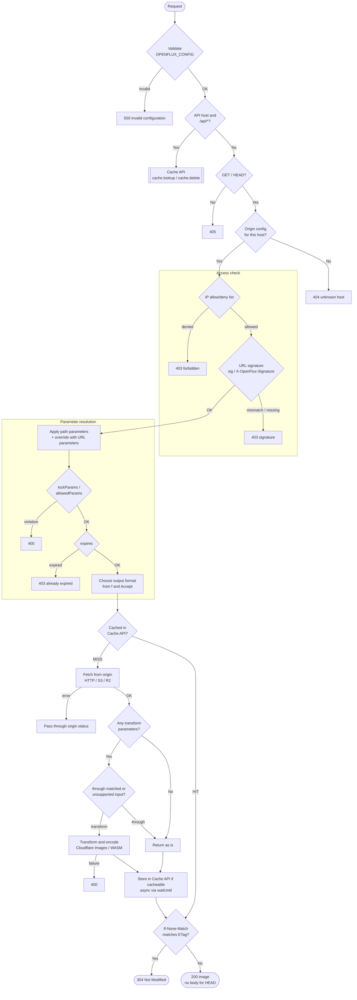
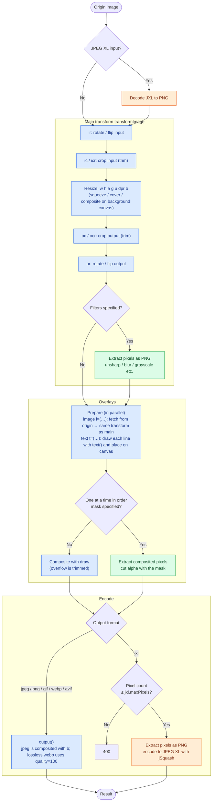

# Architecture

English | [日本語](ARCHITECTURE.ja.md)

The code is split into directories by layer.
Dependencies point `index.ts` → `http` / `infrastructure` → `application` → `domain`, and `domain` performs no I/O.

| Directory              | Responsibility                                                                                                                                                                    |
| ---------------------- | --------------------------------------------------------------------------------------------------------------------------------------------------------------------------------- |
| `src/domain/params/`   | Parser that turns the parameter grammar (`w=400,l=(…)` etc.) into `Params`. Failures are a `Result` of `ParamError`                                                               |
| `src/domain/geometry/` | Computes output size (`ResizePlan`), crop area (`CropArea`), and overlay position                                                                                                 |
| `src/domain/image/`    | Input format detection, `Accept`-based negotiation, pixel math for filters / clipping masks / text line layout, font resolution, and the render port (`ImageRenderer`)            |
| `src/domain/config/`   | zod schema for `OPENFLUX_CONFIG` (types are derived from the schema). CIDRs and the path-parameter grammar are also validated when the config is loaded                           |
| `src/domain/delivery/` | Cache keys, `Cache-Control` decisions, ETag, and the cache port                                                                                                                   |
| `src/domain/access/`   | URL signing (HMAC-SHA256) and access-check errors                                                                                                                                 |
| `src/domain/source/`   | Origin path (`ObjectPath`), fetch results, and the fetch port (`SourceResolver`)                                                                                                  |
| `src/domain/shared/`   | Shared helpers: exhaustiveness check for discriminated unions (`assertNever`), and `schemaResult`, which turns a Standard Schema (zod) result into a `Result`                     |
| `src/application/`     | Workflows: image delivery (`serveImage`) and the cache API. `Result`s are composed with `safeTry`                                                                                 |
| `src/infrastructure/`  | Adapters: Cloudflare Images rendering, HTTP / S3 / R2 origins, Cache API, Purge API, WASM codecs, env validation                                                                  |
| `src/http/`            | Maps workflow errors (discriminated unions) to HTTP responses                                                                                                                     |
| `src/index.ts`         | Composition root. A [Hono](https://hono.dev/) app that validates env, routes requests, wires the adapters, and calls the workflows. Unexpected exceptions become 500 in `onError` |

Error handling:

- Failures where the caller chooses the response (bad parameters, signature mismatch, origin 404, etc.) are returned as `Result` errors (discriminated unions) and exhaustively mapped to responses with `switch` in `src/http/`
- Unexpected failures such as network errors or internal errors from the Images binding propagate as exceptions up to `index.ts` and become 500
- A misconfigured `OPENFLUX_CONFIG` is caught by startup validation and returns 500 `invalid configuration: …`

## Delivery flow

Requests are routed in `src/index.ts`, and image delivery is handled by the workflow in `src/application/serve-image.ts`.
If any step fails, an error containing only the status and a message is returned (`text/plain`, `Cache-Control: no-store`).

- The cache key is the request URL. With alternative-format specs such as `f=webp:auto`, each chosen format is stored under its own key and `Vary: Accept` is added
- Cache lifetime comes from the origin's `Cache-Control` / `Expires`, falling back to `defaultCacheSeconds`, and is capped at the `expires` parameter if present

## Transform pipeline

Transformation happens in `src/infrastructure/cloudflare-image-renderer.ts`, in the order: main transform → overlays → encode.
Colors show where each step runs (blue: Cloudflare Images, green: pixel processing in JS, orange: WebAssembly).

All dimensions are computed up front in `src/domain/geometry/`, and explicit sizes are passed to Cloudflare Images via `fit: "squeeze"` / `"cover"` and `trim`.
Because nothing depends on the semantics of Cloudflare's `fit` modes (such as `scale-down`), rounding and output size are decided by the domain layer.

## Unverified items

The offline Images in `cf dev` only reproduces resize / rotate / format, so the following need to be checked against production Images (`pnpm dev:remote` or a deployment):

- Cropping with `trim`, `gravity: {x, y, mode: "remainder"}` with `fit: "cover"`, and composite positions with `draw()`
- The rotation direction of `rotate` (assumed clockwise), and the dimensions `info()` returns for JPEGs with Exif Orientation
- Text overlays in general (local Images does not support `text()`): the unit of `size`, and how much line spacing and strikethrough positions drift by font
- `purge` in the cache API (whether the Purge API removes Cache API entries)
- Whether `output({ format: "image/webp", quality: 100 })` is lossless
